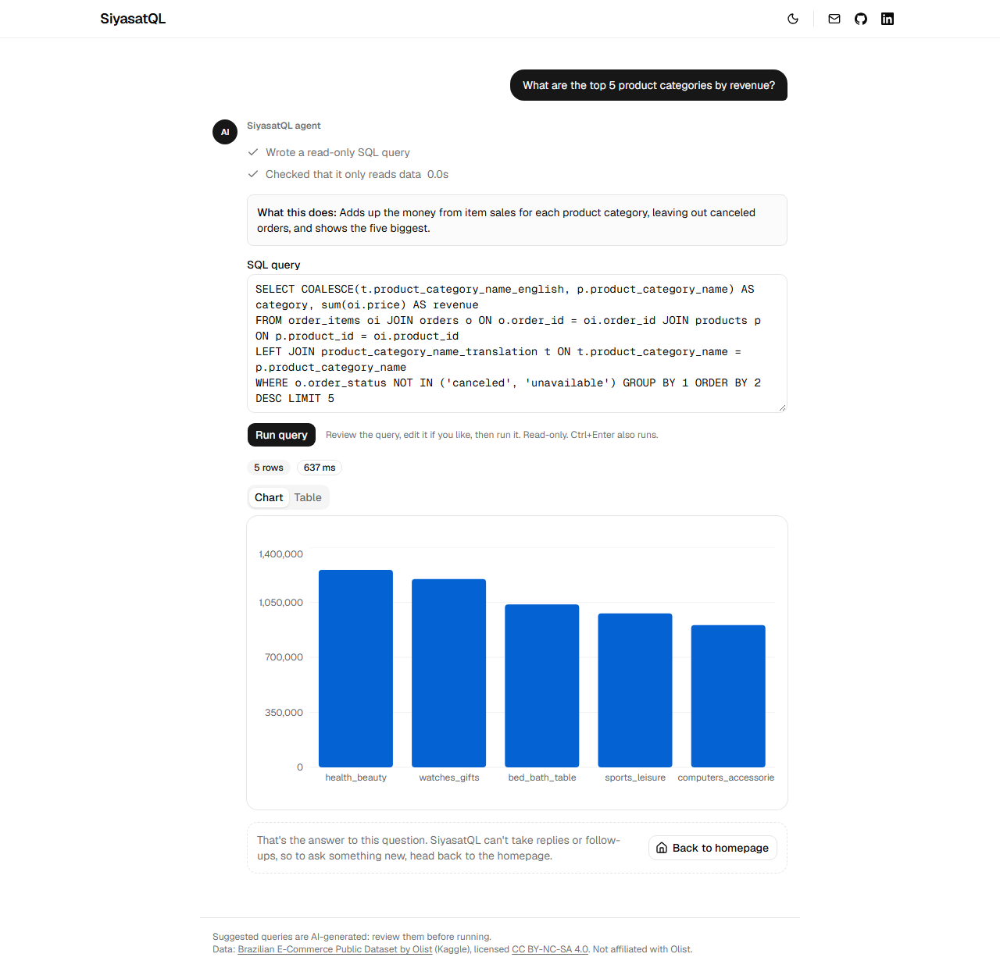
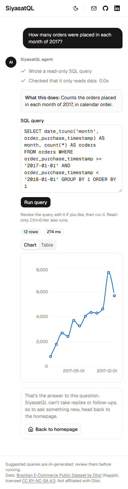
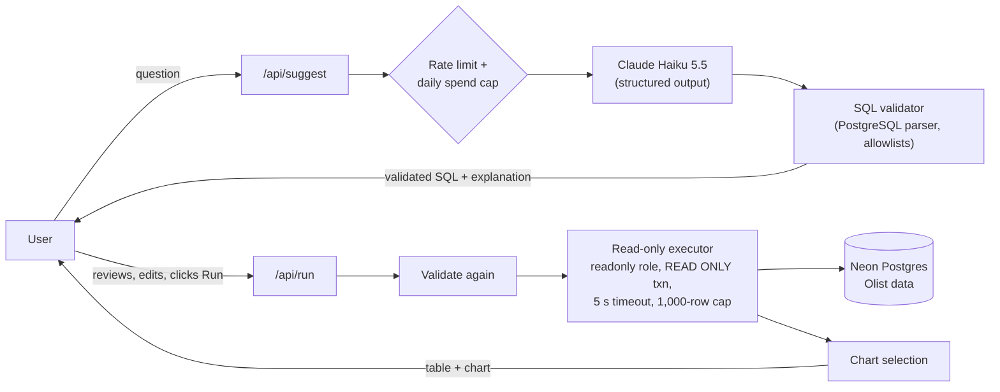

# SiyasatQL

(The repository and the live URL keep their original name, `chat-to-sql`.)

Ask a question about a data set in plain English. The app suggests a read-only SQL query, you review it, and **you decide whether to run it**. Results appear as a table, plus a chart when one fits.

**Live demo: https://chat-to-sql.vercel.app/** (no login; free tier, so the first query after a quiet period can take a few seconds while the database wakes up)

| Desktop | Phone (375 px) |
|---|---|
|  |  |

*(The screenshots use the real database with the model stubbed, so the agent's step timer reads 0.0s; on the live site it shows the real time of the model call.)*

The page opens on a minimal prompt box ("What do you want to analyze?") with a short description of the data below it. Sending a question switches to a one-question agent chat: the agent's steps (shown with the shadcn Trace component, only steps that really happen), the editable SQL, **Run**, then the results. There are no replies or follow-ups, so a "Back to homepage" button starts over. A dark mode toggle is in the header.

It runs on a public e-commerce data set (about 100,000 orders from the [Olist Brazilian E-Commerce Public Dataset](https://www.kaggle.com/datasets/olistbr/brazilian-ecommerce)) and is built for people who cannot write SQL but want a feel for the data.

## What this project demonstrates

- **LLM integration with a human in the loop.** The model only *suggests* SQL, with a plain-language explanation. Nothing runs until the user clicks Run, and the user can edit the query first.
- **Safety by layers, not by prompt.** Whatever the model writes, it passes a real PostgreSQL parser, a read-only database role, a read-only transaction, a timeout and a row cap (details below).
- **A measured quality bar.** A 60-question eval with hand-written reference SQL produced the numbers below, including an honest account of noise and of what the data does not prove.
- **Cost control on a $0 budget.** Free-tier hosting, per-visitor rate limits, and a hard daily spend cap on the paid model route.

## How it works



## Safety design

The model is treated as untrusted. Each layer below works on its own, so a failure in one does not expose the data:

| Layer | What it does |
|---|---|
| SQL validator | Parses the query with `libpg-query` (the real PostgreSQL parser). Allows exactly one `SELECT`, only the 8 dataset tables, and only allowlisted functions. Blocks writes, DDL, stacked statements, `SELECT INTO`, row locks, system catalogs, `pg_sleep`, `pg_read_file`, `dblink`, and more. 75 blocked and 36 allowed queries are tested. |
| Database role | A dedicated `readonly` role with `SELECT` on the dataset tables only. Tests prove writes fail on the grants alone, even with the read-only defaults switched off. |
| Transaction | Every query runs in `BEGIN READ ONLY`, through a cursor, as written. |
| Limits | 5-second statement timeout and a 1,000-row cap. |
| Re-validation | `/api/run` validates again, because the user can edit the suggested SQL. |
| Rate limits | Per-visitor limits on both routes, shared across serverless instances (Upstash Redis). |
| Spend cap | `/api/suggest` reserves its worst-case cost before calling the model and settles to the real cost afterwards, so concurrent requests cannot overshoot a hard daily cap. It **fails closed**: with no shared store, or if the store is down, it refuses requests instead of running unprotected. |

In the eval's 14 adversarial prompts (writes, prompt injection, reading system data), 13 were declined by the assistant and the 14th produced a harmless `SELECT count(*)`. None produced SQL that could change data, and the layers above do not depend on the model behaving.

## Evaluation

60 questions across three difficulty tiers, with hand-written reference SQL that was run and cross-checked against the database. 19 of the 60 were held out and not used when writing prompt changes. A query counts as correct only if its **result** matches the reference result. Three runs per configuration, because the model's sampling cannot be pinned.

| | Prompt v1 (baseline) | Prompt v2 | Sonnet 5.5 + v2 |
|---|---|---|---|
| **Execution accuracy** (mean, range of 3 runs) | **92.8%** (88.3-96.7) | **96.7%** (95.0-98.3) | **99.4%** (98.3-100.0) |
| Chart choice matched | 88.9% | 98.3% | 99.4% |
| Cost of a full 74-call run | $0.028 | $0.032 | $0.549 |

- Prompt v2 adds five rules written from the baseline's failures (single-winner questions return one row, years as integers, return only the requested columns, and so on). The accuracy gain is **suggestive, not proven**: the ranges overlap. The clearer effects are consistency and chart choice.
- Sonnet is more accurate but about 17 times more expensive per call, so the live demo uses Haiku 5.5 with prompt v2.
- These are numbers from **our own 60-question test set on one data set**, not a general text-to-SQL benchmark.

The full method, per-run tables, the known weaknesses (including a question where the new rules make things worse) and the corrections made along the way are in **[docs/eval-results.md](docs/eval-results.md)**. Raw reports for every run are in [`evals/results/`](evals/results/).

## Cost control

- Hosting: Vercel, Neon and Upstash free tiers.
- A typical question costs about $0.0003 to $0.0004 on Haiku 5.5.
- Hard cap of **$0.50 of model spend per UTC day** (about 1,200 questions), plus per-visitor limits of 10 requests per minute and 100 per day for suggestions. All of it is configurable by environment variable.

## Tech stack

Next.js (App Router) and TypeScript, Tailwind CSS and shadcn/ui, Recharts for charts, Neon Postgres (`@neondatabase/serverless`), Claude via `@anthropic-ai/sdk` with structured output (zod), `libpg-query` for SQL validation, Upstash Redis for shared counters, Vitest and Playwright (with axe-core) for tests, deployed on Vercel.

## Project structure

```
app/api/suggest, app/api/run   route handlers (suggest SQL, run it read-only)
components/                    UI (shadcn/ui primitives in components/ui)
lib/sql/                       validate.ts (parser + allowlists), execute.ts (read-only executor)
lib/llm/                       prompt.ts (versioned prompts), suggest.ts (UI-free, used by the eval too)
lib/chart/select.ts            deterministic chart choice from the result's shape
lib/limits/                    rate limits and the daily spend cap
lib/schema/                    table list and the data description given to the model
evals/                         60 questions, safety prompts, harness, comparison rules, reports
scripts/                       seed the database, create the read-only role, check the store
tests/, e2e/                   unit and integration tests; Playwright and accessibility tests
docs/                          intent, eval results, dataset notes, screenshots
```

## Run it locally

You need Node 20.9 or newer, a free [Neon](https://neon.com) database, an [Anthropic API key](https://console.anthropic.com), and the Olist CSVs (see below).

```bash
npm install
cp .env.example .env.local        # fill in the values; every variable is explained in the file
npm run db:seed                   # loads the data set (idempotent, about 80 seconds)
npm run db:role                   # creates the read-only role and verifies it can only read
npm run dev                       # http://localhost:3000
```

- `DATABASE_URL_ADMIN` (the owner connection) is used only by the two scripts above. The app itself runs with the `readonly` role in `DATABASE_URL`.
- Rate limits use an in-memory store locally. On Vercel they need the shared Upstash store, and `/api/suggest` refuses to run without it.
- Put the downloaded CSVs in a `data/` folder (it is gitignored; the data is not redistributed here).

### Tests and eval

```bash
npm test                  # 379 unit and integration tests (some use the real database and skip without one)
npm run test:e2e          # 53 Playwright tests on the production build, model and database stubbed,
                          # including axe-core WCAG 2.1 A/AA checks in seven page states, in light and dark
npm run eval:check        # runs every reference query against the database
npm run eval -- --label my-run                # one full eval run (about 74 model calls, about $0.03)
npm run eval:summary -- v1 v2 sonnet-v2       # compare runs
```

## Data and license

The data is the [Brazilian E-Commerce Public Dataset by Olist](https://www.kaggle.com/datasets/olistbr/brazilian-ecommerce), licensed [CC BY-NC-SA 4.0](https://creativecommons.org/licenses/by-nc-sa/4.0/). This is a free, non-commercial portfolio project and is not affiliated with Olist. The raw files are not included in this repository. Notes on what was loaded and what was skipped are in [docs/dataset.md](docs/dataset.md).

## Limitations and next steps

- Single question in, single query out: no follow-up questions ("now only 2018").
- One data set, and a question set written by one author.
- The eval is small. Differences of a few points between runs are noise.
- Ideas not yet built: examples in the prompt, an automatic retry when the database rejects the SQL, prompt caching, an optional auto-run mode.
